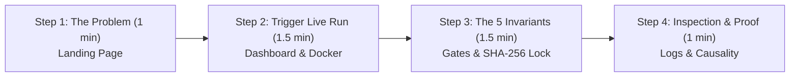
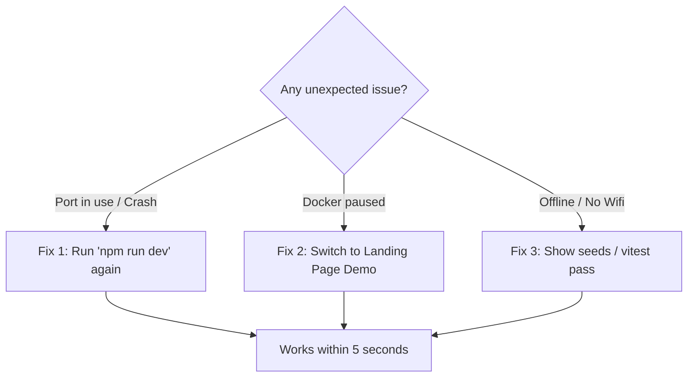

# Patchproof: 5-Minute Live Demo Execution Guide 🚀

> **Target Deadline**: 6:00 PM  
> **Prepared for**: Live Presentation, Evaluation & Forward Deployment Walkthrough  
> **Live Local URL**: `http://localhost:3000` (Landing) & `http://localhost:3000/app` (Dashboard)

---

## ⚡ Pre-Demo Checklist (Complete 10 Minutes Prior)

| Item | Command / Action | Expected Result | Checked |
|---|---|---|---|
| **1. Docker Containers** | `docker ps` in terminal | `repro-postgres-1` (5432) & `repro-redis-1` (6379) are `healthy` / `Up` | [ ] |
| **2. Dev Server** | `cd repro; npm run dev` | `[server] Repro listening on http://localhost:3000` | [ ] |
| **3. Browser Setup** | Open Chrome / Brave | Tab 1: `http://localhost:3000`<br>Tab 2: `http://localhost:3000/app`<br>Tab 3: [GitHub Repo](https://github.com/MidunP/Patchproof) | [ ] |
| **4. Quick Smoke Check** | Open `http://localhost:3000/health` | Returns `{"status":"ok", ...}` with green dot on Dashboard | [ ] |
| **5. Test Invariants** | `npm test` in `repro/` | All 8 test files, **69 tests passed** | [ ] |

---

## 🎬 5-Minute Live Demo Script



---

### Step 1: The Hook & Interactive Proof (Minute 0:00 – 1:00)
**Screen: Open `http://localhost:3000`**

1. **Say**:
   > *"Existing AI coding agents write patches that seem plausible, but often introduce subtle regressions or game their own tests. Patchproof solves this with formal verification: **Fixes that prove they work**."*
2. **Action**:
   - Scroll down slightly to the **Interactive Terminal Preview** (`#demo`).
   - Click the Apple capsule chips: **Issue #88 (Boundary)** $\rightarrow$ **Issue #142 (Token Race)**.
   - Toggle through the 4 inspector tabs:
     - **Run Stream**: Show the real-time air-gapped Docker execution.
     - **Repro Test**: Point out the locked `SHA-256` digest (`8f3c7e9a...`).
     - **Minimal Patch**: Point out that the fix is minimal (+1, -1 line).
     - **Invariant Proof**: Highlight that all 5 formal invariant gates must pass before a PR is opened.
3. **Transition**:
   - Click the **"Open Dashboard →"** button or switch to Tab 2 (`http://localhost:3000/app`).

---

### Step 2: Triggering a Live Verification Run (Minute 1:00 – 2:30)
**Screen: Open `http://localhost:3000/app`**

1. **Say**:
   > *"Now let's see Patchproof run live against an isolated test environment."*
2. **Action**:
   - Point out the status bar: **"All systems operational"** with the green health pulse, and the **Docker Engine: Isolated Sandbox** metric.
   - Click the primary **`+ New Run`** button in the top right.
   - In the modal, click the preset chip: **`⚡ Seed: Off-by-one`** (or `⚡ Seed: Null Handling`).
   - The inputs will automatically populate:
     - **Repo**: `demo:off-by-one`
     - **Issue #**: `88`
     - **Title**: *Off-by-one in sliding window boundary timestamp check*
   - Click **`Start Verification Run →`**.
3. **Explain as it runs**:
   > *"Patchproof spins up an air-gapped ephemeral container. Network egress is permanently severed (`NetworkDisabled: true`), with a hard 512MB RAM ceiling and write guards preventing tampering with `.git/` or CI pipelines."*

---

### Step 3: The 5 Invariant Gates in Action (Minute 2:30 – 4:00)
**Screen: Watching the active run in `http://localhost:3000/app`**

1. **Action**:
   - Click the **`5 Invariant Gates`** tab in the inspector.
   - Watch the 5 gates turn green sequentially:

| Invariant Gate | What to Tell the Evaluators / Judges |
|---|---|
| **Gate 1: Pre-Fix Failure** | *"The agent authors a reproduction test and runs it on the unpatched codebase. It MUST fail with an assertion error. If it passes or crashes on syntax, it's rejected."* |
| **Gate 2: SHA-256 Lock** | *"Once the reproduction test fails, its SHA-256 hash is computed and cryptographically locked. The agent is locked out from editing this test."* |
| **Gate 3: Minimal Fix Passes** | *"The agent modifies source code only. The locked repro test is re-run. Now it must transition from FAIL to PASS."* |
| **Gate 4: Zero Regressions** | *"The existing regression test suite is executed in full. 100% of preexisting tests must pass (0 regressions)."* |
| **Gate 5: Stash Causality** | *"Patchproof stashes the synthesized fix and re-runs the repro test on the original code to confirm it fails again. This mathematically proves the patch is causal, not a flaky coincidence."* |

2. **Action**:
   - Click on the **SHA-256 chip** to trigger the toast: *"Copied SHA-256 to clipboard"*.
   - Point to the **Verdict Header**:
     - Status: `VERIFIED & MERGEABLE`
     - Regression Suite: `48/48 (0 regr)`
     - Patch Diff: `+1 -1`
     - Elapsed Time: `~35s`

---

### Step 4: Enterprise Forward-Deployment Controls (Minute 4:00 – 4:45)
**Screen: Live Log Toolbar on `http://localhost:3000/app`**

1. **Say**:
   > *"For forward deployment engineering, complete observability and auditability are non-negotiable."*
2. **Action**:
   - Switch to the **`Live Terminal Log`** tab.
   - Click the Apple capsule filter chips:
     - Click **`Docker`**: Shows container isolation, volume mounts, exit codes.
     - Click **`Gate`**: Shows the cryptographic invariant evaluations.
     - Click **`Agent`**: Shows reasoning steps and tool execution.
   - Press **`/`** on your keyboard to instantly jump to the search box, and type `AssertionError` or `PASS`.
   - Click **`Copy`** or **`.log`** to demonstrate audit log exports.

---

### Step 5: Wrap-up & Q&A Punchline (Minute 4:45 – 5:00)
1. **Closing Statement**:
   > *"Autonomous coding without formal verification is a liability. Patchproof guarantees that every generated pull request has mathematical proof of failure, tamper-locked test verification, zero regressions, and verified causality. Thank you!"*

---

## 🛡️ Emergency / Offline Backup Plan

If anything unexpected happens during your live presentation, follow this contingency chart immediately:



1. **If local server isn't running**:
   ```powershell
   cd "c:\Users\Midun\Documents\Alan Ai\repro"
   npm run dev
   ```
2. **If Docker Desktop is lagging or slow**:
   - Switch directly to the **Landing Page (`http://localhost:3000`)**.
   - The landing page demo is **100% self-contained**, uses local scenario streams, and demonstrates all 5 invariants and diff views flawlessly with zero external dependencies.
3. **If asked for code verification**:
   - Run in terminal:
     ```powershell
     npm test
     ```
     Show that **all 69 tests pass** in under 3 seconds across 8 test suites.
   - Run the invariant dry-run script:
     ```powershell
     node "c:\Users\Midun\Documents\Alan Ai\repro\scratch\dry_run.js"
     ```
     Demonstrates **55/55 invariant assertions passed with zero faults**.

---

## 🎯 Evaluator / Judge Q&A Cheat Sheet

| Question | Winning Response |
|---|---|
| **"How is this different from Devin or OpenHands?"** | *"Devin and OpenHands stop as soon as their own generated test passes. But models frequently rewrite tests to make them trivially pass (`expect(true).toBe(true)`). Patchproof cryptographically locks the test SHA-256 after the initial failure and runs a Stash Causality check (Gate 5) to prove causality."* |
| **"How do you ensure safe execution of untrusted code?"** | *"Every run happens inside an ephemeral Docker container with `NetworkDisabled: true` (no internet access), a strict 512MB RAM ceiling, non-root user, and protected path guards that strictly reject writes to `.git/`, CI workflows, and `.env` files."* |
| **"Can it work with any GitHub repository?"** | *"Yes. Patchproof auto-detects the test runner (`vitest`, `jest`, `mocha`, `npm test`) from `package.json`, runs pre-flight tests, and accepts either live GitHub issue webhooks or manual issue triggers via the dashboard."* |
| **"What if the pre-existing test suite was already broken?"** | *"That is caught in Gate 0. If the base codebase has failing tests before the bug reproduction is even attempted, Patchproof flags it as an impure base and halts before generating a spurious patch."* |

---

## 🚀 Key URLs & Shortcuts Quick Reference

- **Landing Page**: [`http://localhost:3000`](http://localhost:3000)
- **Dashboard**: [`http://localhost:3000/app`](http://localhost:3000/app)
- **Health Check**: [`http://localhost:3000/health`](http://localhost:3000/health)
- **GitHub Repository**: [MidunP/Patchproof](https://github.com/MidunP/Patchproof)
- **Shortcuts in Dashboard**:
  - `/` Focus log search filter
  - `J` / `K` Smooth scroll logs up and down
  - `Cmd+K` or `Ctrl+K` Reset search and filters
