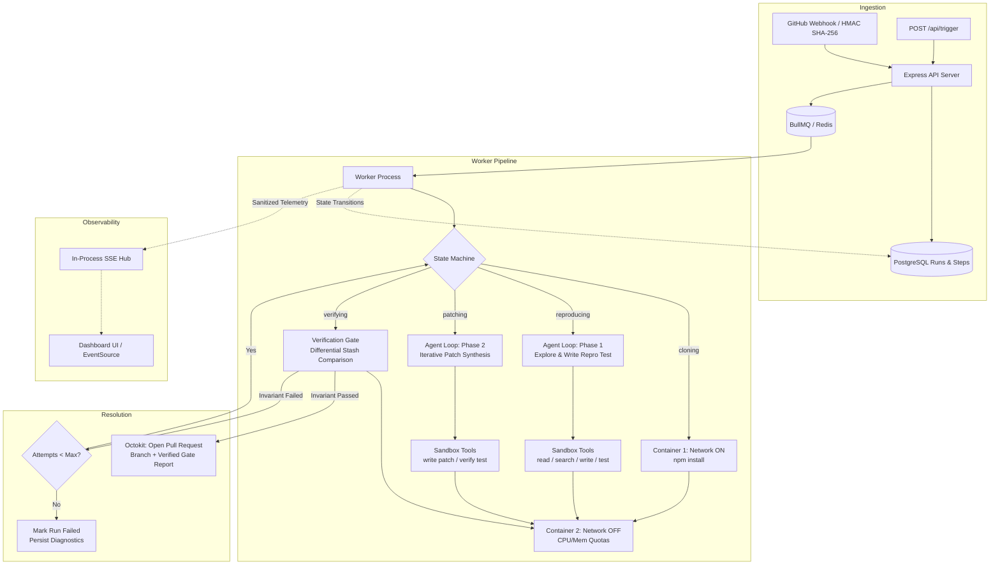

# Repro

Repro is an autonomous bug reproduction and patch verification engine. Given a GitHub issue (via webhook or API trigger), Repro clones the repository into an isolated Docker sandbox, writes a reproduction test that deterministically fails against the buggy code, synthesizes a candidate patch, and opens a pull request **only** when a formal before/after invariant is satisfied.

---

## 1. The Core Invariant

Most LLM coding agents produce candidate patches that are either untested, break existing code, or pass tests that were written after the fix without verifying that they ever failed.

Repro guarantees a pull request is created **if and only if** the following predicate evaluates to `true`:

$$\text{Verify}(C_0, C_{\text{patch}}, T) = \text{Fail}_{\text{assert}}(T, C_0) \land \text{Pass}(T, C_{\text{patch}}) \land \text{Pass}(\text{Suite}, C_{\text{patch}}) \land \text{Integrity}(T)$$

Where:
1. $T$ is the reproduction test written by the agent.
2. $\text{Fail}_{\text{assert}}(T, C_0)$ confirms the test fails against the unpatched codebase $C_0$ **with assertion failures**, not a syntax error, crash, or environment fault.
3. $\text{Pass}(T, C_{\text{patch}})$ confirms $T$ passes with zero failures on the patched tree.
4. $\text{Pass}(\text{Suite}, C_{\text{patch}})$ confirms the full pre-existing test suite passes with zero regressions.
5. $\text{Integrity}(T)$ asserts the SHA-256 digest of $T$ did not change during the patch phase (detecting and rejecting test tampering).

If any check fails, the candidate patch is rejected. The agent receives the compiler/test failure diagnostics and retries up to `AGENT_MAX_ATTEMPTS`. If all attempts fail, the run terminates in an explicit `failed` state and **no PR is opened**.

---

## 2. Architecture & Data Flow



---

## 3. Sandboxing & Threat Model

Repro executes untrusted code from arbitrary repositories and issues. Isolation is enforced through layered host and container controls:

| Boundary | Mechanism | Purpose |
|---|---|---|
| **Network Air-Gap** | `NetworkDisabled: true` | Container network interfaces are dropped immediately after `npm install`. The agent cannot exfiltrate code, download external binaries, or call out to network services. |
| **Compute Limits** | `CpuQuota: 50000`, `CpuPeriod: 100000` | Limits container compute to 50% of a single CPU core to prevent denial-of-service via infinite loops or fork bombs. |
| **Memory Ceiling** | `Memory: 512MB`, `MemorySwap: 512MB` | Strict memory ceiling with swap disabled. Out-of-memory errors terminate the exec process without destabilizing the host. |
| **Path Traversal Protection** | `safePath` in `src/sandbox/tools.ts` | All agent paths are normalized via `path.posix.resolve` against `/workspace`. Requests resolving outside `/workspace` (e.g. `../../etc/passwd` or backslash variants) throw explicit security exceptions. |
| **Protected File Guard** | `isWritePathAllowed` | The agent is forbidden from writing to `/workspace/.git/*`, `/workspace/.github/*`, or `/workspace/.env*`. This prevents git hook injection and workflow tampering. |
| **Output Truncation** | 50,000 character cap | Process outputs are truncated to prevent memory exhaustion and context window overflow in the LLM loop. |
| **Secret Sanitization** | `sanitizeMessage` | Telemetry logs strip GitHub tokens (`ghp_`, `gho_`), OpenAI keys (`sk-`), Bearer tokens, and database connection strings before writing to Postgres or streaming over SSE. |

---

## 4. Verification Gate Protocol

The verification gate (`src/verification/gate.ts`) executes a deterministic 5-step differential cycle:

```
[Candidate Fix Applied on Disk]
              │
              ▼
   Step 0: Hash Check ─────────────► Compute SHA-256 of reproduction test.
              │                     Assert matches original hash (detects tampering).
              ▼
   Step 1: After-Fix Repro Test ───► Run reproduction test.
              │                     Must PASS with 0 failures and >0 assertions.
              ▼
   Step 2: Revert Patch ───────────► Execute `git stash -u` inside sandbox.
              │                     Reverts all source changes (including untracked files).
              ▼
   Step 3: Before-Fix Repro Test ──► Run reproduction test on baseline code.
              │                     Must FAIL with >0 assertion failures.
              │                     (If exit code is non-zero with 0 failures, reject as crash).
              ▼
   Step 4: Restore Patch ──────────► Execute `git stash pop` inside sandbox.
              │                     Restores verified patch.
              ▼
   Step 5: Full Suite Regression ──► Run full pre-existing test suite.
                                    Must PASS with 0 failures.
```

---

## 5. Lifecycle State Machine

Every run follows a strict, persisted state machine:

```
queued ──► cloning ──► reproducing ──► patching ──► verifying ──► pr_opened
                                          ▲             │
                                          └── [Retry] ──┘
                                                │ (Exhausted)
                                                ▼
                                              failed
```

- **Crash-Safe Persistence**: Every transition is committed to the relational `steps` table before the next phase begins. An unhandled exception or worker termination leaves an auditable trail showing the exact state, step duration, and failure reason.
- **Multi-Attempt Loop**: If patching or verification fails, the failure diagnostics (failing assertions or full suite regressions) are passed into the prompt context of attempt $n+1$. The agent adapts its patch until verified or until `AGENT_MAX_ATTEMPTS` is reached.

---

## 6. Directory Structure

```
.
├── Dockerfile                  # Multi-stage production container build
├── docker-compose.yml          # Local infra orchestration (Postgres, Redis, App)
├── package.json
├── tsconfig.json               # CommonJS emit + Bundler resolution
├── vitest.config.mts           # Test runner configuration
├── scripts/
│   └── copy-assets.js          # Cross-platform build script for dist/ assets
├── seeds/                      # Deterministic target repos for demo & testing
│   ├── off-by-one/             # Boundary condition loop bug (Vitest)
│   ├── async-race/             # Concurrency / event-loop race condition (Vitest)
│   └── null-handling/          # Missing null checks & type coercion (Vitest)
├── src/
│   ├── config.ts               # Type-safe environment validation via Zod
│   ├── index.ts                # Express application entry & shutdown lifecycle
│   ├── agent/
│   │   ├── llm.ts              # Decoupled LLMProvider interface & OpenAI implementation
│   │   ├── loop.ts             # Function-calling agent execution engine
│   │   └── prompts.ts          # System & user prompt templates with attempt feedback
│   ├── dashboard/
│   │   └── index.html          # Vanilla HTML5 dashboard (zero build step, SSE consumer)
│   ├── db/
│   │   ├── client.ts           # PostgreSQL pool with allowExitOnIdle
│   │   ├── migrations.ts       # Idempotent DDL migration runner
│   │   ├── runs.ts             # Run, Step, and Log query operations
│   │   └── schema.sql          # Relational DDL with auto-updated timestamps
│   ├── github/
│   │   ├── client.ts           # Octokit client & repository URL parser
│   │   ├── pr.ts               # Git branch pusher & PR formatter
│   │   └── webhook.ts          # HMAC-SHA256 GitHub issue webhook endpoint
│   ├── queue/
│   │   ├── jobs.ts             # BullMQ queue & worker initialization
│   │   └── worker.ts           # Job processor state machine & verification loop
│   ├── routes/
│   │   ├── health.ts           # Dependency liveness probe (/health)
│   │   ├── runs.ts             # Run telemetry REST endpoints (/api/runs)
│   │   └── trigger.ts          # Manual run trigger endpoint (/api/trigger)
│   ├── sandbox/
│   │   ├── clone.ts            # Git clone & demo seed loader
│   │   ├── executor.ts         # Docker container command execution
│   │   ├── runner.ts           # Container lifecycle & resource quotas
│   │   └── tools.ts            # Sandboxed agent tool implementations
│   ├── sse/
│   │   └── stream.ts           # In-process Server-Sent Events hub
│   └── verification/
│       └── gate.ts             # Differential verification gate engine
└── tests/
    ├── agent.test.ts           # Agent reasoning loop unit tests (MockLLMProvider)
    ├── github.test.ts          # Webhook HMAC & URL parser unit tests
    ├── prompts.test.ts         # Prompt construction & attempt feedback tests
    ├── routes.test.ts          # Express API route integration tests
    ├── sandbox.test.ts         # Sandbox memory limits & cleanup tests
    ├── seeds.test.ts           # Seed repository baseline & bug validation tests
    ├── tools.test.ts           # Path traversal & secret scrubbing tests
    └── verification.test.ts    # Verification gate invariant tests
```

---

## 7. Test Suite

The test suite consists of **68 automated tests** covering security boundaries, verification gate failure modes, route handling, agent loops, and demo seed integrity.

```bash
npm test
```

```
 RUN  v5.0.5

 ✓ tests/prompts.test.ts       (4 tests)
 ✓ tests/seeds.test.ts         (8 tests)
 ✓ tests/verification.test.ts  (9 tests)
 ✓ tests/tools.test.ts         (25 tests)
 ✓ tests/agent.test.ts         (4 tests)
 ✓ tests/routes.test.ts        (4 tests)
 ✓ tests/sandbox.test.ts       (7 tests)
 ✓ tests/github.test.ts        (7 tests)

 Test Files  8 passed (8)
      Tests  68 passed (68)
   Duration  3.11s
```

### Static Type Checking
```bash
npm run typecheck
```

---

## 8. Quick Start

### 1. Prerequisites
- Node.js $\ge$ 20
- Docker Desktop or Docker Engine running locally

### 2. Configure Environment
```bash
cp .env.example .env
```
Edit `.env` to provide your `LLM_API_KEY` (OpenAI or compatible gateway). `GITHUB_TOKEN` is optional for local demo runs.

### 3. Start Dependencies
```bash
docker compose up postgres redis -d
```

### 4. Run Development Server
```bash
npm run dev
```

### 5. Verify Liveness Probe
```bash
curl http://localhost:3000/health
```
Response:
```json
{
  "status": "ok",
  "checks": {
    "postgres": { "ok": true },
    "redis": { "ok": true }
  },
  "ts": "2026-10-26T14:40:00.000Z"
}
```

### 6. Trigger a Run Manually
```bash
curl -X POST http://localhost:3000/api/trigger \
  -H "Content-Type: application/json" \
  -d '{
    "repoUrl": "demo:off-by-one",
    "issueNumber": 1,
    "issueTitle": "sumTo returns incorrect total",
    "issueBody": "sumTo(5) returns 10 instead of 15 due to boundary condition."
  }'
```

### 7. Access Dashboard
Navigate to `http://localhost:3000` to view the live timeline, color-coded execution logs, and preset triggers.

---

## 9. Architectural Decisions & Engineering Retrospective

### Decision 1: Differential Git Stash over Dual Containers
- **Alternative**: Spin up two separate containers—one for baseline and one for patched code.
- **Choice**: Single container with `git stash -u` and `git stash pop`.
- **Rationale**: Container initialization and `npm install` are the primary bottlenecks in reproduction latency. Reverting and re-applying patches via Git preserves the container's hot module cache and file state, executing verification in under 3 seconds instead of 45+ seconds.

### Decision 2: In-Process SSE Hub vs Redis Pub/Sub
- **Choice**: In-process `EventEmitter` with per-run channels for the MVP.
- **Trade-off**: Simple, zero-dependency streaming that handles disconnections via database catch-up queries (`getLogsForRun(since)`).
- **Limitation**: Cannot scale horizontally to multi-process deployments without replacing `sseEmitter` with Redis Pub/Sub.

### Decision 3: Robust Token-Independent Test Parsing
- **Problem**: Jest and Vitest emit different summary formats depending on output flags and whether failures occurred. Jest outputs `Tests: 2 failed, 8 passed, 10 total` when tests fail, but `Tests: 8 passed, 10 total` when all pass. Initial regexes assumed `passed` always preceded `failed`.
- **Fix**: Implemented independent line extraction that parses `(\d+)\s+passed` and `(\d+)\s+failed` tokens regardless of order.

### Decision 4: Event Loop Lingering in Integration Tests
- **Problem**: Vitest workers hung after test completion due to idle PostgreSQL pool connections keeping the Node.js event loop active.
- **Fix**: Configured `pg.Pool` with `allowExitOnIdle: true` and configured fallback test credentials in `src/config.ts`. Tests complete and unref cleanly in $<2$ seconds.

### Decision 5: Repo Names with Periods in GitHub URLs
- **Problem**: Repositories like `vercel/next.js` failed URL regex validation because the parser stripped characters after dots.
- **Fix**: Adjusted regex to match `[^/#?]+` and specifically stripped trailing `.git` extensions, supporting dotted package names natively.
