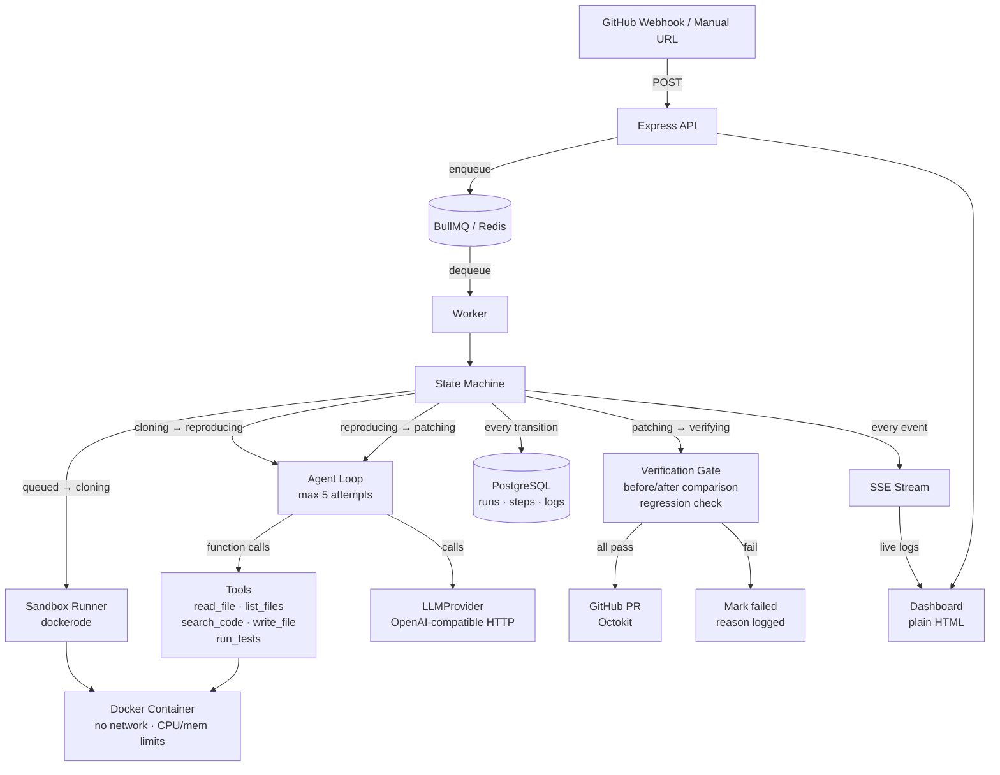

# Repro

> **Automated bug reproduction and patching agent for GitHub issues.**
>
> Given a GitHub issue, Repro clones the repo into an isolated Docker sandbox, writes a failing test that reproduces the bug, proposes a fix, and only opens a PR when the reproduction test **fails before** the fix and **passes after**, and the full suite still passes.

---

## Architecture



---

## Run State Machine

```
queued → cloning → reproducing → patching → verifying → pr_opened
                                                       ↘ failed
```

Every transition is persisted to the `steps` table before the next state begins. A crash at any point leaves enough state to diagnose what happened.

---

## Folder Structure

```
src/
  config.ts          — env loader (Zod, fails fast)
  index.ts           — Express entry, migrations, worker start
  db/
    client.ts        — pg pool + query helpers
    migrations.ts    — run schema.sql on startup
    runs.ts          — data access layer (runs, steps, logs)
    schema.sql       — tables + indexes + trigger
  queue/
    jobs.ts          — BullMQ queue + worker factory
    worker.ts        — job processor (state machine)
  sandbox/
    runner.ts        — dockerode: create/exec/destroy
    executor.ts      — exec commands inside container
    tools.ts         — agent tool implementations
  agent/
    loop.ts          — agent loop (max 5 attempts)
    llm.ts           — LLMProvider interface + OpenAI impl
    prompts.ts       — prompt builders
  verification/
    gate.ts          — before/after comparison + regression
  github/
    webhook.ts       — /webhook route
    client.ts        — Octokit wrapper
    pr.ts            — PR creation with run report
  sse/
    stream.ts        — EventEmitter + SSE attach helpers
  routes/
    health.ts        — GET /health
    runs.ts          — GET /api/runs, GET /api/runs/:id
    trigger.ts       — POST /api/trigger
  dashboard/
    index.html       — plain HTML dashboard (SSE consumer)
seeds/
  off-by-one/        — demo repo: off-by-one bug
  async-race/        — demo repo: async race condition
  null-handling/     — demo repo: null pointer bug
tests/
  verification.test.ts  — unit tests for gate.ts
  sandbox.test.ts       — integration tests for runner.ts
```

---

## Design Decisions

| Decision | Choice | Rationale |
|---|---|---|
| Sandbox isolation | Docker via dockerode | Network disabled after install; CPU/mem/time limits enforced |
| LLM interface | `LLMProvider` interface, one OpenAI-compatible impl | Swap model/provider via env; no vendor-specific code outside `llm.ts` |
| Test framework | Jest or Vitest detected from `package.json` | Simple heuristic, no magic |
| Dashboard | Plain HTML + SSE | Zero build step, no JS framework needed for MVP |
| PR gate | FAIL before, PASS after, full suite passes | Core guarantee — hardcoded, not configurable |
| State persistence | Every transition written to `steps` before next state | Crash-safe audit trail |
| Path traversal | All paths resolved against `/workspace` and rejected if escaping | In `tools.ts` |
| Attempt cap | 5 (hard-coded) | Simple; configurable via env `AGENT_MAX_ATTEMPTS` |
| SSE multi-process | Not supported — single process only | Limitation: Redis pub/sub needed for horizontal scale |

---

## Milestones

| # | Status | What it adds |
|---|---|---|
| M1 | ✅ Done | Skeleton: Express, Postgres, BullMQ, `/health` |
| M2 | 🔲 Next | Sandbox runner: clone, install, run tests |
| M3 | 🔲 | Agent loop end-to-end, hardcoded issue |
| M4 | 🔲 | Verification gate + unit tests |
| M5 | 🔲 | GitHub webhook + PR creation |
| M6 | 🔲 | Live dashboard + SSE timeline |
| M7 | 🔲 | Failure handling, budgets, retries |
| M8 | 🔲 | README final: diagrams, honest limitations |

---

## Quick Start

```bash
# 1. Copy env file and fill in values
cp .env.example .env

# 2. Start dependencies
docker compose up postgres redis -d

# 3. Start dev server (runs migrations automatically)
npm run dev

# 4. Check health
curl http://localhost:3000/health

# 5. Trigger a run manually
curl -X POST http://localhost:3000/api/trigger \
  -H 'Content-Type: application/json' \
  -d '{"repoUrl":"https://github.com/owner/repo","issueNumber":1,"issueTitle":"Bug","issueBody":"..."}'
```

---

## Known Limitations (honest)

- SSE is in-process; horizontal scaling requires Redis pub/sub
- Only targets JS/TS repos with Jest or Vitest
- LLM function calling requires a model that supports it (GPT-4o, etc.)
- Docker socket mount is required; not compatible with rootless Docker without config
- Test detection assumes `npm test` or `npx vitest` — custom test scripts may not work

---

## What Failed and Why

*(Updated as milestones complete)*
