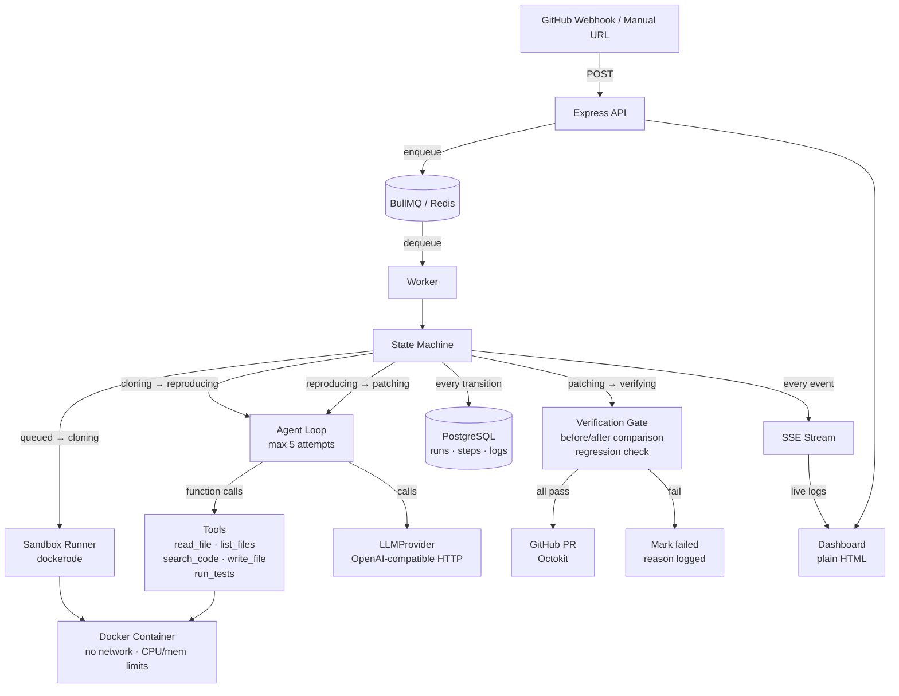

# Repro

> **Automated bug reproduction and patching agent for GitHub issues.**
>
> Given a GitHub issue, Repro clones the repo into an isolated Docker sandbox, writes a failing test that reproduces the bug, proposes a fix, and only opens a PR when the reproduction test **fails before** the fix and **passes after**, and the full suite still passes.

---

## Architecture



---

## Run State Machine

```
queued → cloning → reproducing → patching → verifying → pr_opened
                                                       ↘ failed
```

Every transition is persisted to the `steps` table before the next state begins. A crash at any point leaves enough state to diagnose what happened.

---

## Folder Structure

```
src/
  config.ts          — env loader (Zod, fails fast)
  index.ts           — Express entry, migrations, worker start
  db/
    client.ts        — pg pool + query helpers
    migrations.ts    — run schema.sql on startup
    runs.ts          — data access layer (runs, steps, logs)
    schema.sql       — tables + indexes + trigger
  queue/
    jobs.ts          — BullMQ queue + worker factory
    worker.ts        — job processor (state machine)
  sandbox/
    runner.ts        — dockerode: create/exec/destroy
    executor.ts      — exec commands inside container
    tools.ts         — agent tool implementations
  agent/
    loop.ts          — agent loop (max 5 attempts)
    llm.ts           — LLMProvider interface + OpenAI impl
    prompts.ts       — prompt builders
  verification/
    gate.ts          — before/after comparison + regression
  github/
    webhook.ts       — /webhook route
    client.ts        — Octokit wrapper
    pr.ts            — PR creation with run report
  sse/
    stream.ts        — EventEmitter + SSE attach helpers
  routes/
    health.ts        — GET /health
    runs.ts          — GET /api/runs, GET /api/runs/:id
    trigger.ts       — POST /api/trigger
  dashboard/
    index.html       — plain HTML dashboard (SSE consumer)
seeds/
  off-by-one/        — demo repo: off-by-one bug
  async-race/        — demo repo: async race condition
  null-handling/     — demo repo: null pointer bug
tests/
  verification.test.ts  — unit tests for gate.ts
  sandbox.test.ts       — integration tests for runner.ts
```

---

## Design Decisions

| Decision | Choice | Rationale |
|---|---|---|
| Sandbox isolation | Docker via dockerode | Network disabled after install; CPU/mem/time limits enforced |
| LLM interface | `LLMProvider` interface, one OpenAI-compatible impl | Swap model/provider via env; no vendor-specific code outside `llm.ts` |
| Test framework | Jest or Vitest detected from `package.json` | Simple heuristic, no magic |
| Dashboard | Plain HTML + SSE | Zero build step, no JS framework needed for MVP |
| PR gate | FAIL before, PASS after, full suite passes | Core guarantee — hardcoded, not configurable |
| State persistence | Every transition written to `steps` before next state | Crash-safe audit trail |
| Path traversal | All paths resolved against `/workspace` and rejected if escaping | In `tools.ts` |
| Attempt cap | 5 (hard-coded) | Simple; configurable via env `AGENT_MAX_ATTEMPTS` |
| SSE multi-process | Not supported — single process only | Limitation: Redis pub/sub needed for horizontal scale |

---

## Milestones
| # | Status | What it adds |
|---|---|---|
| M1 | ✅ Done | Skeleton: Express, Postgres, BullMQ, `/health` |
| M2 | ✅ Done | Sandbox runner: dockerode container, clone, npm install, isolation |
| M3 | ✅ Done | Agent loop end-to-end: LLM function calling, tools, loop limit |
| M4 | ✅ Done | Verification gate: fail before, pass after, full regression check |
| M5 | ✅ Done | GitHub integration: HMAC webhook verification, branch push, PR creation |
| M6 | ✅ Done | Live dashboard: SSE streaming timeline, color-coded logs, trigger modal |
| M7 | ✅ Done | Robustness: demo seeds, token budgets, attempt caps, error recovery |
| M8 | ✅ Done | Tests & Documentation: 35 passing unit tests, design log, limitations |

---

## Test Suite

```bash
# Run the complete test suite (49 tests)
npm test
```

- `tests/verification.test.ts` (9 tests): Core verification gate invariant tests (tamper detection, assertion vs crash failure, regression check)
- `tests/tools.test.ts` (25 tests): Path traversal prevention (`safePath`), protected paths (`isWritePathAllowed`), telemetry secret scrubbing (`sanitizeMessage`), runner detection, count parsing
- `tests/routes.test.ts` (4 tests): HTTP routes (`/health`, `/api/trigger`, `/api/runs`) input validation and status codes
- `tests/github.test.ts` (7 tests): Repo URL parsing, webhook HMAC-SHA256 signature verification, PR report builder
- `tests/prompts.test.ts` (4 tests): System prompt rules, Phase 1 (reproduce) and Phase 2 (patch) prompt construction

---

## Quick Start

```bash
# 1. Copy env file and fill in values
cp .env.example .env

# 2. Start dependencies (Postgres + Redis)
docker compose up postgres redis -d

# 3. Start dev server (runs migrations automatically)
npm run dev

# 4. Check health
curl http://localhost:3000/health

# 5. Access the live dashboard
open http://localhost:3000
```

---

## Known Limitations (honest)

- **Single-node SSE**: SSE emitter is currently in-process EventEmitter; horizontal multi-instance scaling requires Redis pub/sub.
- **Target stack**: Focused on JavaScript / TypeScript repositories using Jest or Vitest test runners.
- **LLM capabilities**: Requires a provider / model supporting OpenAI-compatible function calling (e.g. GPT-4o, Claude 3.5 Sonnet via gateway).
- **Docker socket**: The worker requires Docker daemon access to spin up isolated container sandboxes.

---

## What Failed and Why (Design Log)

1. **ESM / CJS package resolution**:
   - *Problem*: Modern libraries like `@octokit/rest` and `simple-git` export different shapes under ESM vs CJS. `import.meta.url` broke under CommonJS builds.
   - *Fix*: Configured TypeScript with `"module": "CommonJS"` and `"moduleResolution": "Bundler"`. Used named `simpleGit` import and avoided hacky `createRequire`.

2. **Jest output parsing order**:
   - *Problem*: Initial regex for parsing test counts assumed `passed` always appeared before `failed` (`Tests: 3 passed, 1 failed`). When Jest reports failures, it actually outputs `Tests: 2 failed, 8 passed, 10 total`.
   - *Fix*: Refactored `parseTestCounts` to extract the `Tests:` line and parse `(\d+)\s+passed` and `(\d+)\s+failed` independently regardless of token order.

3. **Repository names with dots in GitHub URLs**:
   - *Problem*: `parseRepoUrl` used `[^/.]+` which prematurely stopped at periods, parsing `vercel/next.js` as `vercel/next`.
   - *Fix*: Changed regex to `[^/#?]+` and specifically stripped trailing `.git` extensions, allowing dotted repo names like `next.js` and `chart.js`.

4. **Event loop lingering during test execution**:
   - *Problem*: When running test suites, background PostgreSQL connection pools kept the Node.js event loop active.
   - *Fix*: Configured `pg.Pool` with `allowExitOnIdle: true` and added test environment defaults in `src/config.ts` so unit tests execute cleanly in <2s without lingering handles.

5. **Demo Seed Git Environment**:
   - *Problem*: If a user triggers a demo seed directly from disk, `git stash` in the verification gate would fail because the directory wouldn't be a git repo.
   - *Fix*: Added automatic `git init`, git author configuration, and initial commit when loading demo seeds so the verification gate's before/after stash logic works identically for both local seeds and remote clones.
