# 🎥 Patchproof: 2-Minute Demo Video Script & Step-by-Step Recording Guide

> **Hackathon Target**: 1–2 Minute Video (90–120 Seconds Max)  
> **X Launch Window**: 7:30 PM IST (Quote official launch post)  
> **Submission Window**: 8:00 PM – 10:00 PM IST  

---

## ⏱️ Video Time Budget (Exactly 100 Seconds)

```mermaid
gantt
    title 2-Minute Video Timeline (100 Seconds Total)
    dateFormat  X
    axisFormat %s s
    section Script Flow
    Hook & The Problem (0s - 18s)        : 0, 18
    Landing & Interactive Proof (18s - 45s) : 18, 45
    Live Dashboard & 5 Invariants (45s - 75s) : 45, 75
    How We Used Alan AI (75s - 92s)       : 75, 92
    Closing & Call to Action (92s - 100s) : 92, 100
```



---

## 🎬 Second-by-Second Recording & Voiceover Script

### Scene 1: The Problem & The Hook (0:00 – 0:18)
- **Screen**: Fullscreen browser on `http://localhost:3000` (Hero section visible).
- **Camera / Cursor**: Smoothly hover over headline *"Fixes that prove they work"*.
- **Voiceover**:
  > *"Most AI coding agents generate patches that seem plausible, but often hallucinate, break existing code, or game their own tests.  
  > Meet **Patchproof**—an autonomous bug reproduction and formal verification engine that delivers fixes that mathematically prove they work before any pull request is opened."*

---

### Scene 2: Interactive Proof Preview (0:18 – 0:42)
- **Screen**: Scroll down slightly to the terminal console (`#demo`).
- **Cursor Actions**:
  1. Click **`Issue #88 (Boundary)`**, then click **`Issue #142 (Token Race)`**.
  2. Click the **`Repro Test`** tab $\rightarrow$ hover over the locked SHA-256 badge.
  3. Click **`Minimal Patch`** $\rightarrow$ show the clean unified diff.
  4. Click **`Invariant Proof`** $\rightarrow$ show the 5 green invariant passes.
- **Voiceover**:
  > *"When a GitHub issue arrives, Patchproof doesn't just guess code. It authors a reproduction test that MUST fail first on the unpatched codebase.  
  > Once it fails, Patchproof cryptographically locks its SHA-256 digest so the AI cannot cheat or relax test assertions. Only when a minimal fix passes all 5 invariant gates is a PR synthesized."*

---

### Scene 3: Live Verification Run & Air-Gapped Sandbox (0:42 – 1:15)
- **Screen**: Click **`Dashboard`** in navbar $\rightarrow$ jumps to `http://localhost:3000/app`.
- **Cursor Actions**:
  1. Click top-right **`+ New Run`**.
  2. Click the preset chip: **`⚡ Seed: Off-by-one`** (auto-fills repo, issue #88, and title).
  3. Click **`Start Verification Run →`**.
  4. Select the active run card from the sidebar $\rightarrow$ show live SSE log stream and the **`5 Invariant Gates`** tab.
  5. Click the **`Docker`** and **`Gate`** filter chips.
- **Voiceover**:
  > *"In our live dashboard, Patchproof executes entirely inside an air-gapped Docker container with network egress severed, a strict 512MB RAM ceiling, and write guards protecting Git history.  
  > Notice the 5 gates:  
  > Gate 1 verifies pre-fix failure.  
  > Gate 2 locks the test SHA.  
  > Gate 3 verifies the minimal patch passes.  
  > Gate 4 confirms zero regressions across the entire pre-existing test suite.  
  > And Gate 5 performs a differential stash check—re-breaking the test on base code to prove causal correctness, not flaky luck."*

---

### Scene 4: How We Used Alan AI to Bring It to Life (1:15 – 1:35) ⭐ *CRITICAL JUDGING CRITERIA*
- **Screen**: Quick split-screen or 3-second cut to VS Code showing `npm test` passing (69/69 tests) and TypeScript architecture.
- **Voiceover**:
  > *"We used **Alan AI** as our principal forward deployment engineer to architect this entire system from scratch in under 24 hours.  
  > Alan AI designed the 5-invariant formal state machine, implemented the air-gapped Docker sandbox runner, wrote an exhaustive 69-test Vitest suite, and crafted our Apple-inspired frosted glass interface. Alan AI enabled us to ship production-grade verification at breakneck speed."*

---

### Scene 5: Outro & Call to Action (1:35 – 1:45)
- **Screen**: Return to `http://localhost:3000` showing the GitHub icon button and hero.
- **Voiceover**:
  > *"Autonomous coding without formal verification is a liability. Patchproof brings mathematical proof to AI software engineering.  
  > Check out our open-source repo on GitHub at `MidunP/Patchproof`. Thank you!"*

---

## 🛠️ Step-by-Step Recording Instructions

### Tool Recommendations:
- **Option 1 (Easiest)**: **Loom** (Chrome extension or desktop app) — records screen + webcam in bottom circle with 1 click.
- **Option 2 (Built-in Windows)**: Press **`Win + Alt + R`** (Windows Game Bar Screen Recorder) or **`Win + Shift + S`** (Snipping Tool Video mode).
- **Option 3**: **OBS Studio** or **Screen Studio**.

### Pre-Recording Setup (2 Minutes):
1. **Resolution**: Set your browser zoom to `100%` or `110%` for crisp text readability.
2. **Hide Bookmarks Bar**: Press `Ctrl + Shift + B` in Chrome to hide browser bookmarks for a clean look.
3. **Audio**: Use a quiet room and headphones/mic for clean voiceover.
4. **Dev Server Alive**: Make sure `npm run dev` is running in `repro/` on `http://localhost:3000`.

---

## 🐦 Ready-to-Post X / Twitter Launch Copy (For 7:30 PM IST)

When Alan AI's official video goes live on X at 7:30 PM, click **Quote Post** and paste this:

```text
🚀 Introducing Patchproof — Fixes that prove they work.

Most AI coding agents hallucinate patches and game their own tests. Patchproof changes that:
🔒 Air-gapped Docker sandbox (NetworkDisabled: true)
🔑 Tamper-proof SHA-256 test locking
🛡️ 5 Formal Invariant Gates + Stash Causality Proof
📊 0 regressions, verified PRs

Built in 24h with @AlanAI as our principal forward deployment engineer.

💻 GitHub: https://github.com/MidunP/Patchproof
🎥 Full 1-min demo below 👇
```
